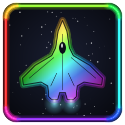

# Star Chroma

Razer Chroma lighting for Starsector 0.98a. The game talks to the Razer Chroma SDK that Razer Synapse / the Razer Chroma app runs on your PC (`localhost:54235`), so there's nothing extra to install.

## What it does

**Campaign**
- The keyboard background follows your fleet's movement status:
  - **Normal travel**: almost-dark light blue slowly breathing up to light blue.
  - **Running silent** (Go Dark, or moving slowly): a very dim purple / dark purple wave.
  - **Sustained Burn**: an orange, red and yellow star field streaming past, with a wobbling red line through the middle haloed in orange.
  - **Emergency Burn**: the same, darker, redder and much faster.
- Abilities add their own effects on top:
  - **Neutrino Detector**: a breathing blue glow around the edge of the keyboard.
  - **Active Sensor Burst**: light gathers in the middle while it charges, then a white ring expands outward.
  - **Interdiction Pulse**: the keyboard dims and a ring closes in, ticking faster as it charges, then a bright pulse and an echo blast outward.
  - **Transverse Jump**: purple and dark purple tendrils close in on the middle while it charges, and snap back once the jump goes through.
- Set `starchroma_baseMode` to `spectrum`, `wave` or `static` for a fixed background instead.
- Keys **1–0** match the ability bar: light blue = ready, red (slow pulse) = active, cooling down or not usable right now. Each key flashes white when its ability is ready again. Empty slots show the background.
- **Tab** (map), **E** (intel), **C**, **F**, **R**, **I** glow light blue.
- Mouse, headset, mousepad etc. keep your own Synapse lighting (set `starchroma_campaignAllDevices` to `true` to light them too).

**Combat** (every Chroma device)
- Everything turns light white.
- Shields on: light blue fills the LEDs from the bottom to the top, then drains when you drop them. Phase cloak does the same in violet.
- Flux: the white heats up to deep red-orange; the shield colour goes blue → violet → red-orange.
- Hull damage: a red flash on every hit, and as hull drops, keys flicker off, show glitch colours (sparks, red, magenta, cyan) and eventually die for good.
- Overload: electric white-blue crackle. Venting: fast pulsing.
- Flagship destroyed: a white flash, a ring of fire expanding from the middle of each device, embers, then total darkness except **Tab** (command screen), which pulses light blue. Taking command of another ship brings the lights back.

On the title screen and when you quit, the mod releases Chroma and your normal Synapse lighting comes back.

## Settings

`data/config/settings.json`:

| key | default | |
|---|---|---|
| `starchroma_baseMode` | `status` | campaign keyboard background: `status` (movement + abilities), or fixed `spectrum`, `wave`, `static` |
| `starchroma_baseColor` | `[0,255,64,255]` | colour for `static` |
| `starchroma_baseBrightness` | `0.4` | brightness of the fixed backgrounds |
| `starchroma_brightness` | `1.0` | overall brightness |
| `starchroma_campaignAllDevices` | `false` | also drive non-keyboard devices in the campaign |
| `starchroma_readyColor` / `starchroma_usedColor` | light blue / red | ability key colours |

Hotkey colours assume the default key bindings.

## Building

No JDK needed: `sh build.sh` compiles with the game's own JRE and Janino. `sh build.sh test` renders every effect to `build/preview/effects.png`; `sh build.sh live` also plays them on your devices; `sh build.sh install` copies the mod into the game.
