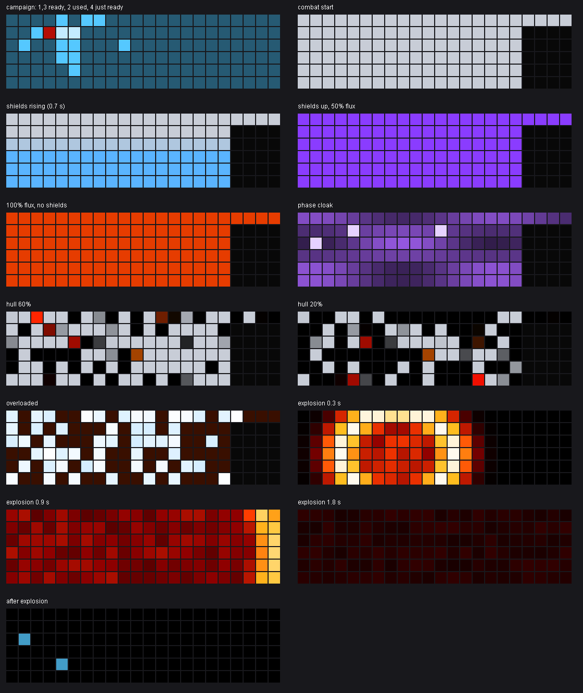
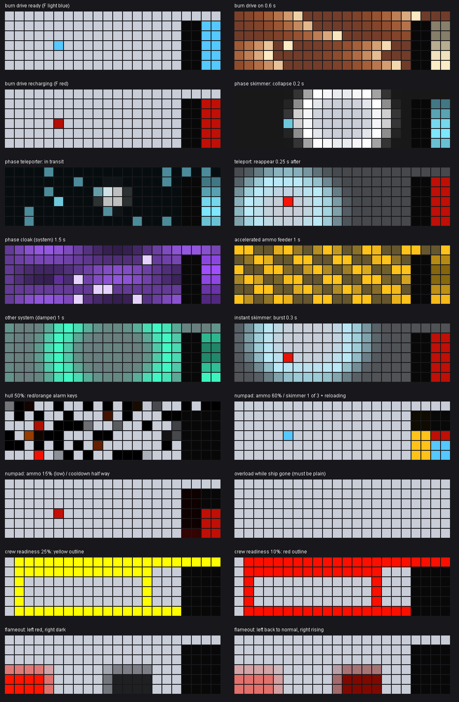
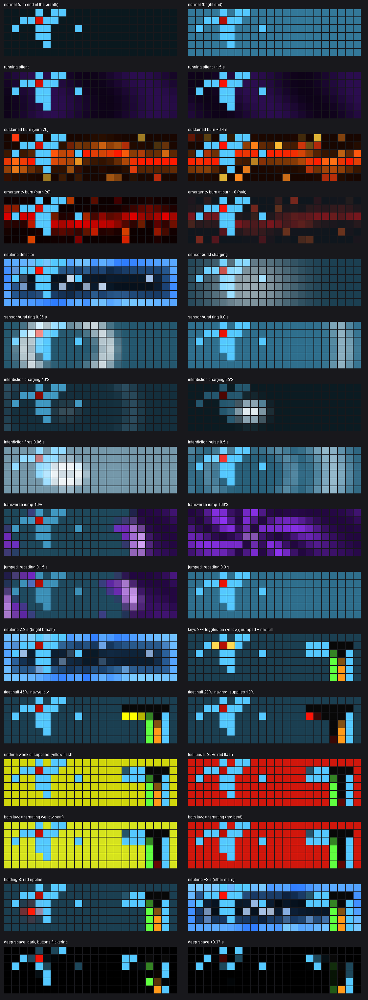

# Star Chroma

Razer Chroma lighting for Starsector 0.98a. The game talks to the Razer Chroma SDK that Razer Synapse / the Razer Chroma app runs on your PC (`localhost:54235`), so there's nothing extra to install.

## Install

1. Download **[StarChroma.zip](https://github.com/toasty-wheeler/starsector-chroma/releases/latest/download/StarChroma.zip)** from the [latest release](https://github.com/toasty-wheeler/starsector-chroma/releases/latest).
2. Unzip it into `Starsector/mods/` so you get `mods/StarChroma/mod_info.json`.
3. Enable **Star Chroma** in the launcher. No other mods needed; safe to add to or remove from an existing save.

Requirements: Starsector 0.98a, Windows, Razer Synapse (or the Razer Chroma app) running with Chroma Connect / app lighting allowed. No Razer hardware? The [Razer Chroma Emulator](https://github.com/WyvrnOfficial/ChromaEmulator) shows the effects on virtual devices.

## Preview

Rendered by `sh build.sh test` (keyboard, mouse, keypad, mousepad, headset, Chroma Link):

| Combat | Ship systems, gauges, alarms | Campaign |
|---|---|---|
|  |  |  |

## What it does

**Campaign**
- The keyboard background follows your fleet's movement status:
  - **Normal travel**: almost-dark light blue slowly breathing up to light blue.
  - **Running silent** (Go Dark): a very dim purple / dark purple wave.
  - **Sustained Burn**: an orange, red and yellow star field streaming past, with a wobbling red line through the middle haloed in orange.
  - **Emergency Burn**: the same, darker, redder and much faster.
  - Both follow your burn level: at a standstill they look like normal travel, and as the fleet speeds up the burn effect fades in and its star field moves faster, reaching full strength and speed at burn 20.
- Abilities add their own effects on top:
  - **Neutrino Detector**: a steady blue outline around the keyboard that weaves in and out (reaching about a row deeper at its crests), while the middle goes dark with stars slowly twinkling on random keys.
  - **Holding S** (move slowly): a single red wave spreads out from the S key (a new one every 1.4 s, the first the moment the key goes down), passing over the lit hotkeys too, only while the key is held on the campaign map (not when the fleet slows for Go Dark, a sensor burst, an interdiction pulse or standing still). Let go and the wave already out finishes spreading and fades.
  - **Active Sensor Burst**: light gathers in the middle (on the keyboard: the middle of the letter keys, G/H) while it charges, then a white ring expands outward, over the lit hotkeys and everything else.
  - **Interdiction Pulse**: the keyboard dims and a ring closes in on the middle of the letter keys, ticking faster as it charges, then a bright pulse and an echo blast outward. Drawn over the hotkeys too.
  - **Transverse Jump**: purple and dark purple tendrils close in on the middle of the letter keys while it charges, and snap back once the jump goes through. They cover the hotkeys too.
  - **Deep space** (the abyssal edge of hyperspace and the abyssal star systems out there): the keyboard goes black and the lit buttons flicker on and off at random, like failing lights. Abilities still draw on the dark keyboard. It fades back when you leave.
- Set `starchroma_baseMode` to `spectrum`, `wave` or `static` for a fixed background instead.
- Keys **1–0** match the ability bar: light blue = ready, yellow slowly cycling to white-yellow = a toggle that is switched on (Transponder, Neutrino Detector, Go Dark, Sustained Burn...), red (slow pulse) = charging, cooling down or not usable right now. Each key flashes white when its ability is ready again. Empty slots show the background.
- **Tab** (map), **E** (intel), **C**, **D**, **F**, **R**, **I**, **F2** (codex), **F4** (quicksave) and **F5** (quickload) glow light blue.
- Numpad (full-size keyboards): three bars filling from the bottom: **supplies** (green, share of cargo capacity), **fuel** (orange, share of the tank) and fleet **readiness** (light blue, average CR). A bar pulses red under 20%.
- Insert / Home / Page Up / Page Down / End / Delete show the fleet's average hull: they go dark one by one clockwise from Insert as hull drops; light blue, yellow under 50%, red under 30%.
- The whole background flashes yellow with less than a week of supplies, red with less than 20% fuel, and alternates red and yellow when both are low.
- Mouse: the left side strip shows supplies (green) and the right side fuel (orange), filling from the bottom and pulsing red under 20%. The wheel and logo blink yellow with under a week of supplies, red under 20% fuel, and alternate red / yellow when both are low (`starchroma_campaignMouse`: `false` leaves the mouse on your Synapse lighting).
- Headset, mousepad etc. keep your own Synapse lighting (set `starchroma_campaignAllDevices` to `true` to light them too).

**Combat** (every Chroma device)
- Everything turns light white.
- Shields on: light blue fills the LEDs from the bottom to the top, then drains when you drop them. Phase cloak does the same in violet, with drifting ghostly bands and glints.
- Ship system (**F**): the F key is light blue when the system is ready, glows in the system's colour while it runs, and is red while it recharges. Each kind of system has its own effect:
  - Charge (Burn Drive, Plasma Burn, Maneuvering/Plasma Jets, Full Burn, Convulsive Lunge): the lights drop to embers and hot white-orange streaks race across them.
  - Teleport (Phase Teleporter, Phase Skimmer, Displacer): the light collapses into the middle, flickers as dim cyan static while you're in transit, then bursts back out from a random spot.
  - Phase (Phase Cloak as the system): the violet phase effect above.
  - Weapon boost (Accelerated Ammo Feeder, Fast Missile Racks, High Energy Focus, Targeting Feed): brass ammo-belt dashes run along the rows with muzzle-flash flicker.
  - Anything else (Damper Field, Fortress Shield, Temporal Shell, modded systems...): teal rings roll out from the middle.
  Modded systems are sorted by their id (anything with "burn", "jets", "teleport", "skimmer", "phase", "feed" and so on).
- Flux: the white heats up to deep red-orange; the shield colour goes blue → violet → red-orange.
- Hull damage: a red flash on every hit. As hull drops, more and more keys go dark for good (none until 15% damage, about 60% when wrecked), some keys slowly fade to black and back every 1.5-3 s, and a few slowly blink red/orange to black about once a second. Each key keeps its role, so nothing jumps around.
- Low crew readiness (combat readiness, CR) on your flagship: the outline of the keyboard and the mousepad blink yellow at 30% CR or less, and faster red at 15% or less. The keyboard outline traces both the outer edge of a full-size board and the main typing block, so 60% and TKL boards (Huntsman Mini) get a complete frame.
- Mouse side strips: the left side is an ammo gauge for the selected weapon group (or all ammo weapons if that group has none), brass, turning pulsing red below 25% and blinking red when empty. The right side shows the ship system: its charges stacked from the bottom in light blue with the reloading one in dim red, or for systems without charges, light blue when ready, the system's colour while on, and a red bar refilling during cooldown.
- Numpad (full-size keyboards): split into two bars that fill from the bottom, ammo on the left half (Num Lock, 7, 4, 1, 0 side) and the ship system charges / cooldown on the right half, coloured the same way as the mouse sides. The mouse wheel and logo show the ship system like the F key: light blue ready, its colour while on, red while recharging.
- Overload: electric white-blue crackle that slows down, thins out and lets the board come back as the overload wears off, like the ship is fixing itself. Venting: fast pulsing.
- Engine flameout: the bottom-left and bottom-right corners of the main keyboard take turns. One side glows red while the other is dark, then the dark side turns red and the red side fades back to normal, until the engines relight.
- Flagship destroyed: a white flash, a ring of fire expanding from the middle of the letter keys (G/H) on the keyboard and from the middle of every other device, embers, then total darkness except **Tab** (command screen) and **X**, which pulse light blue. Taking command of another ship brings the lights back.

On the title screen and when you quit, the mod releases Chroma and your normal Synapse lighting comes back.

## Settings

`data/config/settings.json`:

| key | default | |
|---|---|---|
| `starchroma_baseMode` | `status` | campaign keyboard background: `status` (movement + abilities), or fixed `spectrum`, `wave`, `static` |
| `starchroma_baseColor` | `[0,255,64,255]` | colour for `static` |
| `starchroma_baseBrightness` | `0.4` | brightness of the fixed backgrounds |
| `starchroma_brightness` | `1.0` | overall brightness |
| `starchroma_campaignAllDevices` | `false` | also drive non-keyboard devices in the campaign |
| `starchroma_campaignMouse` | `true` | campaign mouse shows supplies / fuel and blinks on low stock |
| `starchroma_readyColor` / `starchroma_usedColor` | light blue / red | ability key colours |
| `starchroma_frameMs` | `66` | time between lighting frames (66 = 15 fps). Raise it (80-100) if animations stutter and then rush to catch up; lower it if your setup keeps up |

Hotkey colours assume the default key bindings.

## Troubleshooting

- `starsector.log` lines starting with `Star Chroma` say whether the mod reached the Chroma SDK.
- If the log says it's connected but your devices don't change, Synapse is receiving the lighting but not applying it: check that app lighting / Chroma Connect is on in Synapse, restart Synapse, or reinstall its Chroma module. The Chroma Emulator is a quick way to confirm the mod itself works.

## Building

No JDK needed: `sh build.sh` compiles with the game's own JRE and Janino. `sh build.sh test` renders every effect to `build/preview/*.png`; `sh build.sh live` also plays them on your devices; `sh build.sh install` copies the mod into the game.
